# Найкращі практики

Як писати лабораторні, практичні й курсові в шаблоні `nure`, щоб документ одразу відповідав ДСТУ 3008:2015, легко підтримувався й не мав прихованих помилок. Усі зображення нижче згенеровані цим самим шаблоном із наведених поруч прикладів коду.

Зміст:
1. [Структура проєкту й дані роботи](#1-структура-проєкту-й-дані-роботи)
2. [Титульна сторінка й вибір макета](#2-титульна-сторінка-й-вибір-макета)
3. [Заголовки й інтервали](#3-заголовки-й-інтервали)
4. [Короткі функції та мітки з префіксами](#4-короткі-функції-та-мітки-з-префіксами)
5. [Рисунки й пастка `path()`](#5-рисунки-й-пастка-path)
6. [Таблиці й перенос між сторінками](#6-таблиці-й-перенос-між-сторінками)
7. [Формули, десяткові коми й пояснення познак](#7-формули-десяткові-коми-й-пояснення-познак)
8. [Код, лістинги й рядковий код](#8-код-лістинги-й-рядковий-код)
9. [Списки, примітки й виноски](#9-списки-примітки-й-виноски)
10. [Перелік джерел і додатки](#10-перелік-джерел-і-додатки)
11. [Чекліст перед здачею](#11-чекліст-перед-здачею)

---

## 1. Структура проєкту й дані роботи

### Розділяйте `doc.toml` і `main.typ`

У `doc.toml` тримайте те, що не змінюється між роботами з однієї дисципліни (університет, дисципліна, автори, викладачі) -- тоді для наступної лабораторної файл достатньо скопіювати без правок. Тип, номер і тему передавайте вже в `main.typ`.

<table>
<tr>
<th align="left" width="50%">Добре (<code>src/doc.toml</code>)</th>
<th align="left" width="50%">Поширена помилка в TOML</th>
</tr>
<tr>
<td valign="top">

```toml
# Поля роботи -- завжди НА ПОЧАТКУ файлу
university = "ХНУРЕ"
subject = "СМП"
done-date = 2026-12-27   # дата без лапок!

[[authors]]
name = "Косач Л. П."
edu-program = "КУІБ"
group = "24-1"
gender = "f"
variant = 8

[[mentors]]
name = "Шевченко Т. Г."
degree = "Доцент кафедри ПІ"
gender = "m"
```

</td>
<td valign="top">

```toml
[[authors]]
name = "Косач Л. П."
edu-program = "КУІБ"
group = "24-1"
gender = "f"

[[mentors]]
name = "Шевченко Т. Г."
gender = "m"

# ✗ Потрапить у останнього викладача,
#   а не в корінь роботи!
subject = "СМП"
# ✗ У лапках це рядок, а не datetime
done-date = "2026-12-27"
```

</td>
</tr>
</table>

- **Не редагуйте файли пакунка**, щоб додати нову дисципліну, кафедру чи університет: опишіть їх у локальному `data.yaml` і передайте в `work(..., data: yaml("data.yaml"))` (див. [Дані роботи](data.md#власні-дисципліни-й-університети)).
- **Збирайте роботу з блоків**, а не через рецепти (`pz-lb`, `coursework`): конструктори прозоріші, підтримують `data:`, перевизначення слотів титулки та працюють із `mise run rename` (який очікує `#let w = work(...)`).
- **Великі роботи розбивайте на файли** через `#include "chapters/ch1.typ"`. У кожному підключеному файлі, де є `fig`, `tab`, `note` або `spacing`, повторюйте `#import "@vendor/nure:0.3.0": *`.

---

## 2. Титульна сторінка й вибір макета

Базова ініціалізація будь-якої роботи має три кроки: зібрати дані через `work(...)`, записати метадані PDF (`#set document(..w.document)`) і ввімкнути стиль ДСТУ (`#show: style.dstu.with(skip: 1)`) **до** виклику титулки, щоб перша сторінка лишилася без номера, а наступна отримала «2».

```typst
#import "@vendor/nure:0.3.0": *
#import style: spacing

#let w = work(..toml("doc.toml"), type: "ЛБ", number: 2, title: "Потік керування та алгоритмічні структури Bash")

#set document(..w.document)
#show: style.dstu.with(skip: 1)

#report.title-page(w)                     // макет "default" (типовий ХНУРЕ)
// #report.title-page(w, layout: "complex")  // спеціальність і ОП у шапці, кілька авторів
// #report.title-page(w, layout: "nure-iki") // методичні вимоги кафедри ІКІ (2024)
```

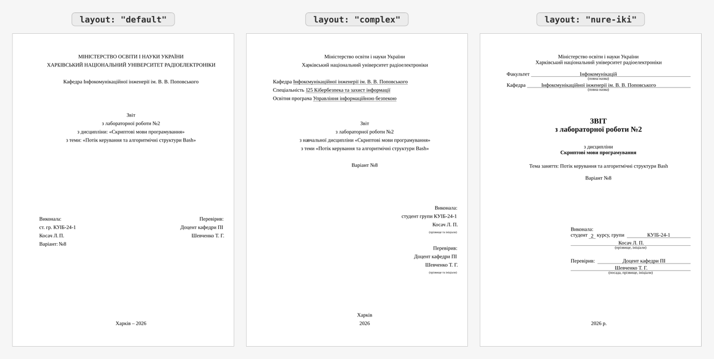

Якщо потрібно змінити лише один блок титулки (наприклад, додати підгрупу чи змінити місто), не переписуйте всю сторінку -- перевизначте потрібний слот (`header`, `info`, `credentials`, `footer`), доповнивши типовий вміст:

```typst
#report.title-page(
  w,
  info: [#report.nure.default-info(w) \ Підгрупа 2],
  footer: [Київ -- 2026],
)
```

---

## 3. Заголовки й інтервали

### Прибирайте подвійний інтервал між суміжними заголовками

За ДСТУ 3008:2015 (п. 7.1.24) відстань між заголовком і текстом -- два міжрядкові інтервали, а між двома суміжними заголовками -- один. Шаблон не знає наперед, чи йде після заголовка інший заголовок, тому між ними ставте `#v(-spacing)` (потрібен `#import style: spacing`). Це стосується і пари `#title-heading(w)` → `== Мета роботи`.

<table>
<tr>
<th align="left" width="50%">Без <code>#v(-spacing)</code> — зайвий проміжок</th>
<th align="left" width="50%">Із <code>#v(-spacing)</code> — правильно за ДСТУ</th>
</tr>
<tr>
<td valign="top">

```typst
== Хід роботи
=== Підготовка середовища
Встановлено необхідні пакунки та перевірено
версію компілятора.
```

</td>
<td valign="top">

```typst
== Хід роботи
#v(-spacing)
=== Підготовка середовища
Встановлено необхідні пакунки та перевірено
версію компілятора.
```

</td>
</tr>
</table>

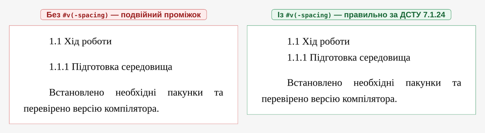

### Ненумеровані розділи й перевизначення `plain-heading`

- Структурні елементи («Вступ», «Висновки») оформлюйте через `#utils.nheading[Вступ]` -- заголовок потрапить у зміст без номера.
- Не ставте крапку в кінці заголовків і підписів (вимога ДСТУ).
- Якщо для звіту потрібні заголовки 1-го рівня без номера й без розриву сторінки -- поєднуйте `style.overrides.plain-heading` із `section-numbering: false`, щоб формули, рисунки й таблиці мали чисту наскрізну нумерацію (`(1)`, `Рисунок 1`), а підрозділи автоматично нумерувалися без початкового `0.` (`1`, `1.1`):

<table>
<tr>
<th align="left" width="50%">Код</th>
<th align="left" width="50%">Результат</th>
</tr>
<tr>
<td valign="top">

```typst
#show: style.dstu.with(section-numbering: false)
#show: style.overrides.plain-heading

= Звіт з практичної роботи
#v(-spacing)
== Постановка задачі
У першому пункті розглянуто базові вимоги.
Обчислення виконуються за @eq:sum[формулою]:
$ S = sum_(i=1)^n x_i $ <eq:sum>

=== Вхідні параметри
Підрозділи нумеруються без початкового «0.»
(`1`, `1.1`).
```

</td>
<td valign="top">

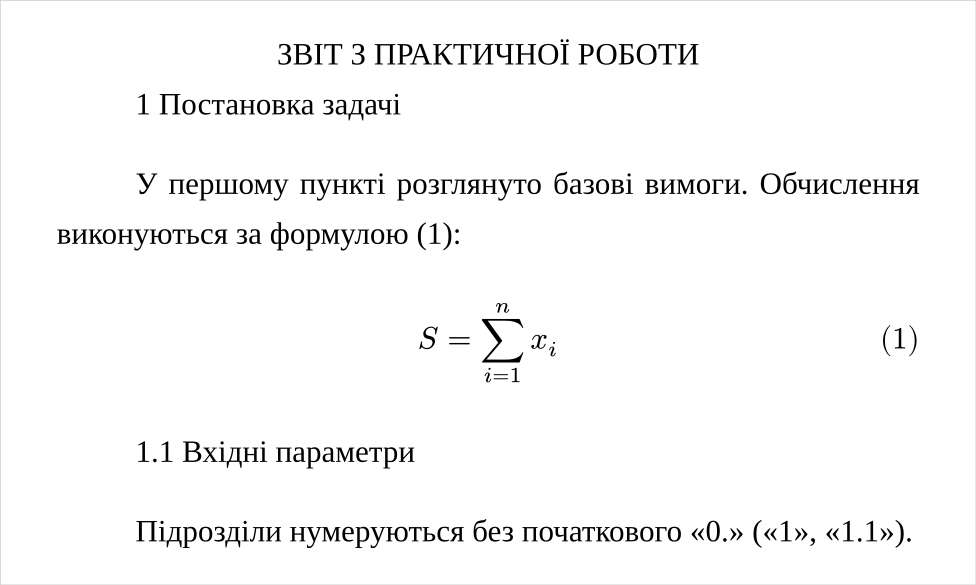

</td>
</tr>
</table>

---

## 4. Короткі функції та мітки з префіксами

Використовуйте короткі назви `fig`, `tab`, `note`, `bib` замість повних (`dstu-figure`, `dstu-table`, `dstu-note`, `dstu-bibliography`) -- це ті самі функції, але текст стає помітно чистішим.

Додавайте до всіх міток префікс типу елемента:

| Елемент | Префікс | Приклад мітки | Посилання з відмінком |
| --- | --- | --- | --- |
| Розділ / підрозділ / пункт | `sec:`, `sub:`, `pt:` | `<sub:arch>` | `у @sub:arch[підрозділі]` |
| Рисунок | `fig:` | `<fig:arch>` | `на @fig:arch[рисунку]` |
| Таблиця | `tab:` | `<tab:results>` | `у @tab:results[таблиці]` |
| Формула | `eq:` | `<eq:energy>` | `за @eq:energy[формулою]` |
| Лістинг | `lst:` | `<lst:main>` | `у @lst:main[лістингу]` |
| Додаток | `app:` | `<app:code>` | `у @app:code[додатку]` |

Так мітки ніколи не конфліктують між собою і з ключами `bibl.yml`, а редактор (Tinymist) зручно фільтрує підказки за `@fig:` чи `@tab:`.

<table>
<tr>
<th align="left" width="50%">Код</th>
<th align="left" width="50%">Результат</th>
</tr>
<tr>
<td valign="top">

```typst
У @sub:arch[підрозділі] розглянуто структуру
сервісу (див. @fig:arch[рисунок]). Заміри
продуктивності зведено у @tab:results[таблиці],
а розрахунок виконано за @eq:energy[формулою].
Повну реалізацію наведено у @lst:main[лістингу].
```

</td>
<td valign="top">

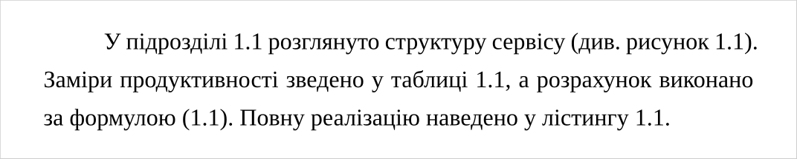

</td>
</tr>
</table>

---

## 5. Рисунки й пастка `path()`

- **Завжди обгортайте шлях у `path(...)`** під час передачі в `fig` і `bib`: звичайний рядок Typst шукає відносно теки пакунка, а `path("figures/arch.svg")` запам'ятовує розташування вашого файлу.
- **Джерело рисунка** задається третім позиційним аргументом:
  - не передавати -- лише назва («Рисунок 1.1 – Назва»);
  - `none` -- додає «(рисунок виконано самостійно)»;
  - `"cisco.com"` -- додає «(за даними cisco.com)».
- **Примітку до рисунка** передавайте через параметр `note:`, а не окремим `#note[...]` нижче: за ДСТУ 7.5.9 примітка має стояти під зображенням **перед** підписом.

<table>
<tr>
<th align="left" width="50%">Код</th>
<th align="left" width="50%">Результат</th>
</tr>
<tr>
<td valign="top">

```typst
Взаємодію компонентів зображено на
@fig:arch[рисунку].

#fig(
  path("figures/arch.svg"),
  [Архітектура мікросервісу],
  none,
  note: [Обмін між шлюзом і сервісом
    відбувається за протоколом gRPC.],
  label: <fig:arch>,
  width: 92%,
)
```

</td>
<td valign="top">

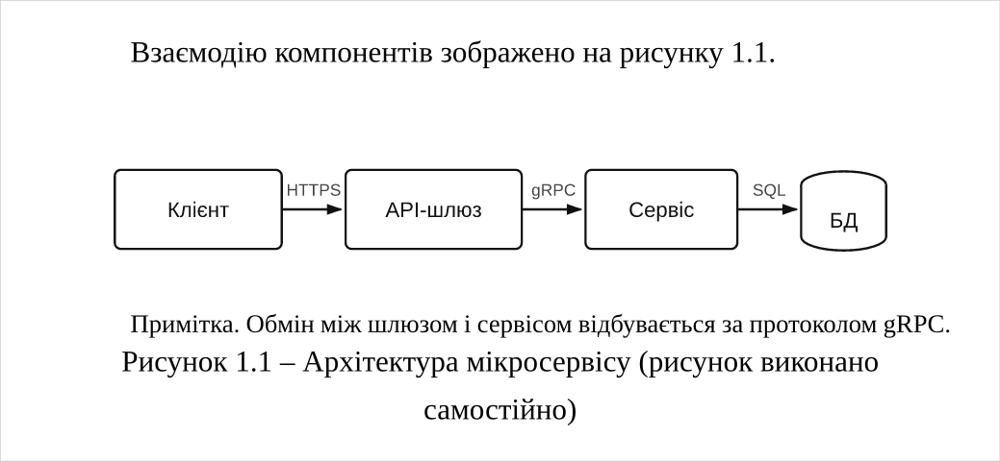

</td>
</tr>
</table>

---

## 6. Таблиці й перенос між сторінками

### Використовуйте `tab` і `note:`

Функція `tab` автоматично загортає шапку в `table.header(...)`, піднімає підпис над таблицею з абзацним відступом (ДСТУ 7.6.8) і розміщує `note:` всередині нижньої рамки таблиці без повторення на інших сторінках (ДСТУ 7.8.2).

<table>
<tr>
<th align="left" width="50%">Код</th>
<th align="left" width="50%">Результат</th>
</tr>
<tr>
<td valign="top">

```typst
Результати вимірювань наведено в
@tab:perf[таблиці].

#tab(
  caption: [Порівняння режимів кешування],
  columns: (2.2fr, 1.5fr, 1.5fr),
  align: (left, center, center),
  header: ([Режим], [Затримка, мс], [RPS]),
  note: [Середнє значення за 10 000 запитів
    при 64 потоках.],
  label: <tab:perf>,
  [Без кешу], [42,5], [1 480],
  [In-memory], [4,1], [15 200],
  [Redis], [7,8], [8 150],
)
```

</td>
<td valign="top">

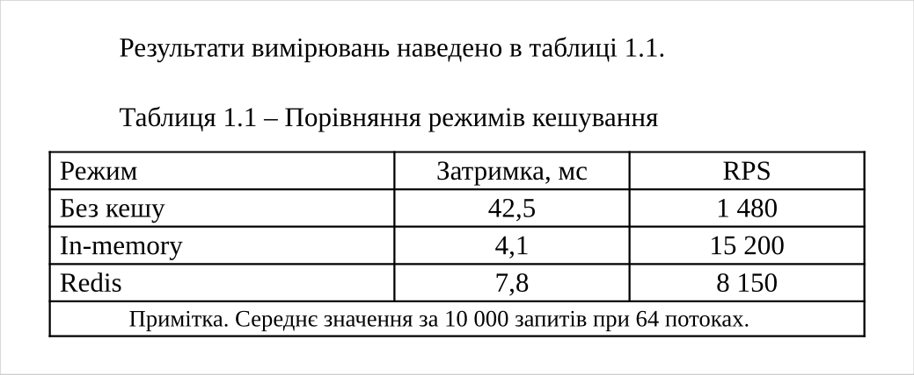

</td>
</tr>
</table>

### Довгі таблиці переносяться автоматично

Не розбивайте довгу таблицю вручну і **не додавайте `placement: top`** (плаваюча фігура в Typst не розривається). Звичайна `tab(...)` (або `figure(table(table.header(...), ...))`) сама переходить на наступні сторінки, повторює шапку й додає написи «Продовження таблиці N» / «Кінець таблиці N»:

```typst
#tab(
  caption: [Результати тестування вузлів],
  columns: (0.7fr, 2.5fr, 1.5fr, 1.5fr),
  align: (center, left, center, center),
  header: ([№], [Вузол], [Затримка, мс], [Статус]),
  label: <tab:nodes>,
  [1], [api-gateway-01], [8,2], [ОК],
  // ... решта рядків
)
```

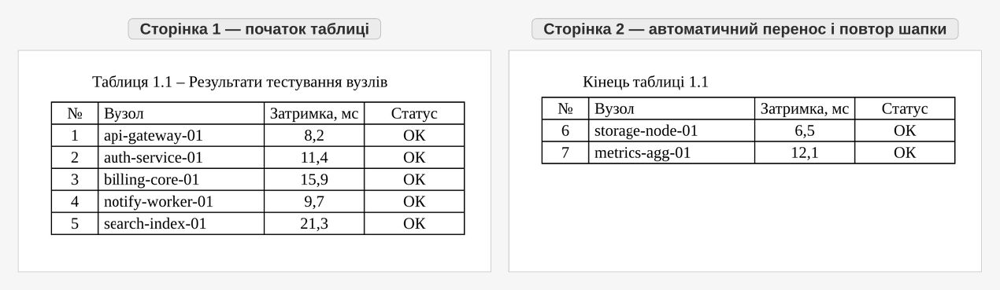

> Якщо таблиця надто складна для `tab` (багаторівнева шапка з `colspan`/`rowspan`), пишіть звичайний `#figure(table(table.header(...), ...), caption: [...]) <tab:...>` -- головне не забути `table.header(...)`, інакше шапка не повториться при переносі.

---

## 7. Формули, десяткові коми й пояснення познак

Три правила, про які найчастіше забувають:

1. **Номер з'являється лише за наявності посилання** (ДСТУ 7.10.2). Якщо формула має `<eq:...>` і на неї є `@eq:...` у тексті -- номер `(1.1)` ставиться автоматично. Якщо посилання немає -- номер прибирається без пропусків у нумерації.
2. **Пояснення познак починайте з `#utils.noindent де ...`** без двокрапки після «де» (ДСТУ 7.10.6). Без `utils.noindent` рядок отримає абзацний відступ 1,25 см.
3. **Десяткові дроби у формулах пишіть із крапкою** (`$0.85$`), шаблон сам перетворить їх на кому (`0,85`). Аргументи функцій із дробами розділяйте крапкою з комою (`$f(1.5; 2.5)$`), бо `$f(1.5, 2.5)$` дасть неоднозначне `f(1,5, 2,5)`.

<table>
<tr>
<th align="left" width="50%">Код</th>
<th align="left" width="50%">Результат</th>
</tr>
<tr>
<td valign="top">

```typst
Частотну ефективність обчислюємо за
@eq:eff[формулою]:
$ beta = gamma / (2^gamma - 1) $ <eq:eff>
#utils.noindent де $gamma = 1.5$ -- частотна
ефективність, біт/(с·Гц); $beta$ -- енергетична
ефективність.

Проміжна оцінка без посилання номера не отримує:
$ f(1.5; 2.5) = 0.85 dot beta $
```

</td>
<td valign="top">

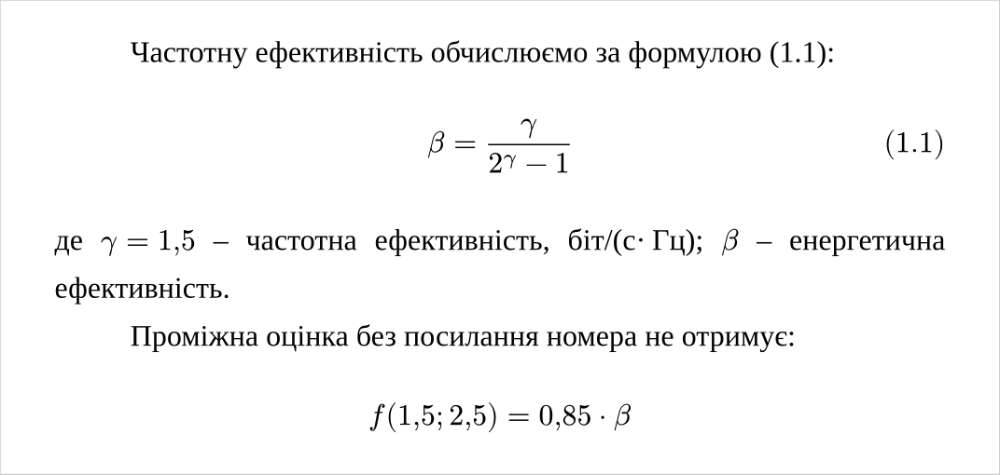

</td>
</tr>
</table>

---

## 8. Код, лістинги й рядковий код

- **Лістинг із підписом і переносом** -- загортайте блок коду у `#figure(..., caption: [...]) <lst:...>`. Підпис «Лістинг 1.1 – …» стане над кодом, а довгий лістинг переноситиметься між сторінками з «Продовження / Кінець лістингу».
- **Довгі файли коду** не копіюйте вручну в `.typ` -- читайте напряму через `#raw(read("src/main.c"), lang: "c", block: true)` (для додатків це особливо зручно: код у звіті завжди актуальний).
- **Рядковий код** (`` `mise run watch` ``) за ДСТУ виводиться основним шрифтом у лапках. Якщо на кафедрі вимагають або дозволяють моноширинний рядковий код, додайте `#show: style.overrides.inline-code` після `#show: style.dstu`.

<table>
<tr>
<th align="left" width="50%">Код</th>
<th align="left" width="50%">Результат</th>
</tr>
<tr>
<td valign="top">

````typst
// Лістинг із підписом
#figure(
  ```bash
  for f in src/*.typ; do
    typst compile "$f"
  done
  ```,
  caption: [Пакетна компіляція файлів],
) <lst:build>

// Рядковий код (типово -- ДСТУ, у лапках)
Збірка запускається командою `mise run watch`,
а дані роботи беруться з `src/doc.toml`.

// Або з моноширинною плашкою:
#show: style.overrides.inline-code.with(
  fill: luma(240),
)
````

</td>
<td valign="top">

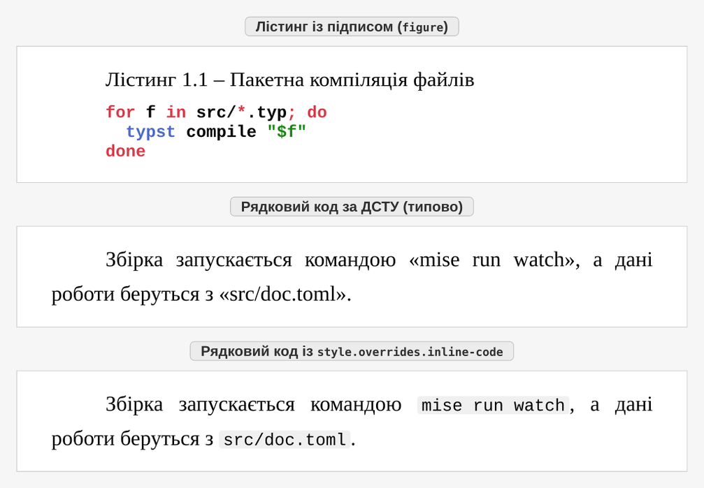

</td>
</tr>
</table>

---

## 9. Списки, примітки й виноски

- **Списки**: використовуйте звичайні `+` і `-`. Шаблон сам виставляє `а)` → `1)` → `–`, зсув на 1,25 см на кожному рівні й повернення перенесених рядків до лівого берега (ДСТУ 7.7.4). За автором лишається пунктуація: пункти з малої літери через `;`, останній -- із `.`.
- **Примітки**: передавайте текст у `#note[...]` без слова «Примітка.» -- шаблон сам підставить «Примітка.» для однієї і «Примітка 1.», «Примітка 2.» для кількох (`#note[...][...]`).
- **Виноски**: `#footnote[...]` автоматично скидає нумерацію на кожній новій сторінці й додає лінію 35 мм. Слідкуйте, щоб на одній сторінці було **не більше 4 виносок** (ДСТУ 7.9.3).

<table>
<tr>
<th align="left" width="50%">Код</th>
<th align="left" width="50%">Результат</th>
</tr>
<tr>
<td valign="top">

```typst
Основні етапи налаштування
середовища#footnote[Перевірено на Typst 0.15.1
у Linux і Windows.]:
+ підготовка даних роботи у `doc.toml`:
  + заповнення реквізитів автора та викладача;
  + вибір скорочення дисципліни:
    - вбудована назва або власний `data.yaml`;
+ компіляція документа й перевірка полів,
  інтервалів і перенесення довгих рядків
  переліку від лівого берега.

#note[Один аргумент формує ненумеровану
  примітку.]
#note[Перша з кількох приміток.][Друга примітка
  нумерується автоматично.]
```

</td>
<td valign="top">

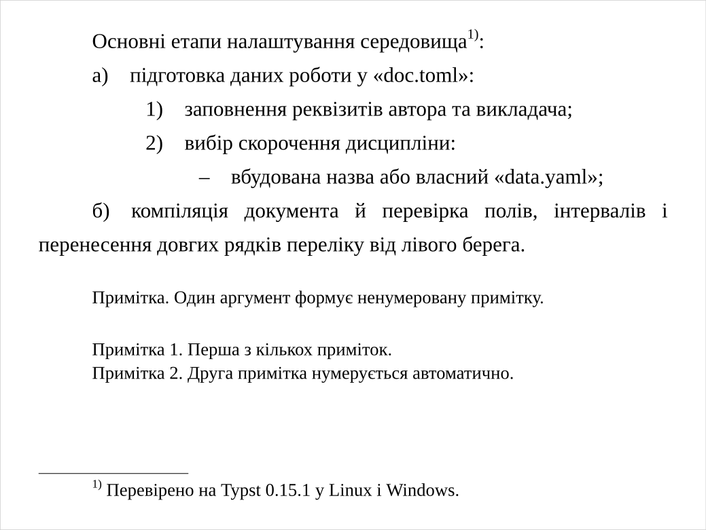

</td>
</tr>
</table>

---

## 10. Перелік джерел і додатки

### Порядок наприкінці документа

Завжди дотримуйтеся послідовності:

1. Основні розділи (`= ...`)
2. `#utils.nheading[Висновки]`
3. `#bib(path("bibl.yml"))` -- **обов'язково перед додатками**
4. `#show: style.appendices` і самі додатки (`= ...`)

### Оформлення джерел і додатків

- У `bibl.yml` використовуйте перевірені типи **`Book`** і **`Web`** (інші типи Hayagriva не гарантують відповідність ДСТУ).
- Для великої курсової додатки зручно тримати в окремому файлі: `#style.appendices(include "chapters/appendices.typ")`.

```typst
#bib(path("bibl.yml"), style: "3008") // або style: "8302" для cw-v2

#show: style.appendices
= Знімки екрана
#fig(path("figures/screen.svg"), [Панель моніторингу вузлів], width: 88%, label: <fig:monitor>)
```

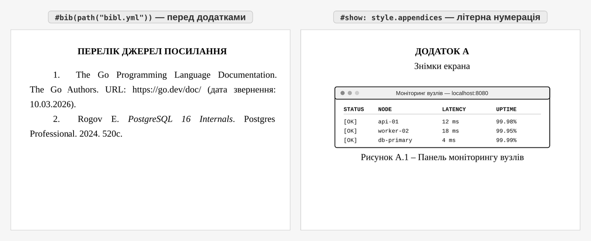

---

## 11. Чекліст перед здачею

- [ ] У `doc.toml` усі поля роботи стоять **до** першого `[[authors]]`/`[[mentors]]`, а дати записані без лапок.
- [ ] `#set document(..w.document)` і `#show: style.dstu.with(skip: 1)` викликано **до** титульної сторінки.
- [ ] Між усіма суміжними заголовками (`#title-heading(w)` → `==`, `==` → `===`) стоїть `#v(-spacing)`.
- [ ] У кінці заголовків і підписів рисунків/таблиць немає крапок; у переліках -- мала літера, `;` і `.` в останньому пункті.
- [ ] Усі файли в `fig(...)` і `bib(...)` обгорнуті в `path(...)`.
- [ ] Усі формули, яким потрібен номер, мають мітку `<eq:...>` і посилання `@eq:...`; під формулами стоїть `#utils.noindent де ...`.
- [ ] На жодній сторінці немає більше 4 виносок (`#footnote`).
- [ ] Перелік джерел (`bib`) стоїть **перед** `#show: style.appendices`.
- [ ] Готовий PDF переглянуто очима (переноси, поля, підписи) і перейменовано через `mise run rename`.
